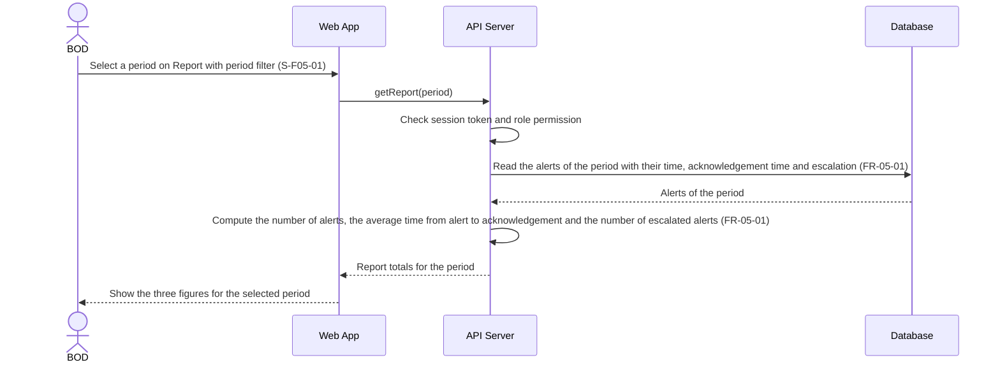

# Sequence Diagram: SD-UC-10 View reports

Analysis level: how the parts of the Dien Hong System talk to each other when a member of the
Board of Directors views the report of a period. The lifelines are the elements of the
[physical design](../architecture/architecture.md). The BOD member's choice of period is shown in
the activity diagram for UC-10, not here.

| Field | Value |
|---|---|
| Use case | UC-10 View reports |
| Version | v1 |
| FRs | FR-05-01 |

FR-05-01 describes one straight exchange with no outcome decided inside the system, so the diagram
has no `alt` fragment. Choosing another period repeats the same exchange and is not drawn as a
second fragment. The API Server computes the totals (Architecture: "Compute reports") and the
Database only keeps the alerts, so the Database lifeline is read, never written. The supplied
requirements do not say what is shown when the period has no alerts, how alerts that were never
acknowledged count in the average, or how a report is refused for a user without permission (the
project-wide login assumption covers the session and role check), so none of these is drawn.
