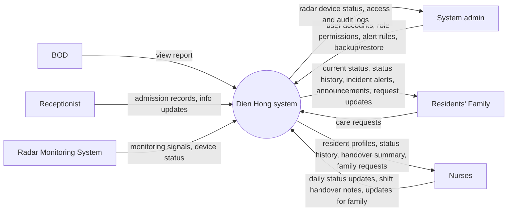

# Context Diagram: Dien Hong system

Dien Hong system is one black box in the middle; around it are the external entities it
exchanges data with. The Context Diagram answers "what does the system interact with?".

| Field | Value |
|---|---|
| Version | v1 |
| Built from | CVCA: every stakeholder that exchanges information with the Dien Hong system |

## Diagram

## Data crossing the boundary

| External entity | Sends to the system | Receives from the system |
|---|---|---|
| BOD | View report | (none) |
| Receptionist | Admission records, info updates | (none) |
| System admin | User accounts, role permissions, alert rules, backup/restore | Radar device status, access and audit logs |
| Residents' Family | Care requests | Current status, status history, incident alerts, announcements, request updates |
| Radar Monitoring System | Monitoring signals, device status | (none) |
| Nurses | Daily status updates, shift handover notes, updates for family | Resident profiles, status history, handover summary, family requests |

## Change log

| Version | Change |
|---|---|
| v1 | First version: BOD, Receptionist, System admin, Residents' Family, Radar Monitoring System, Nurses |
