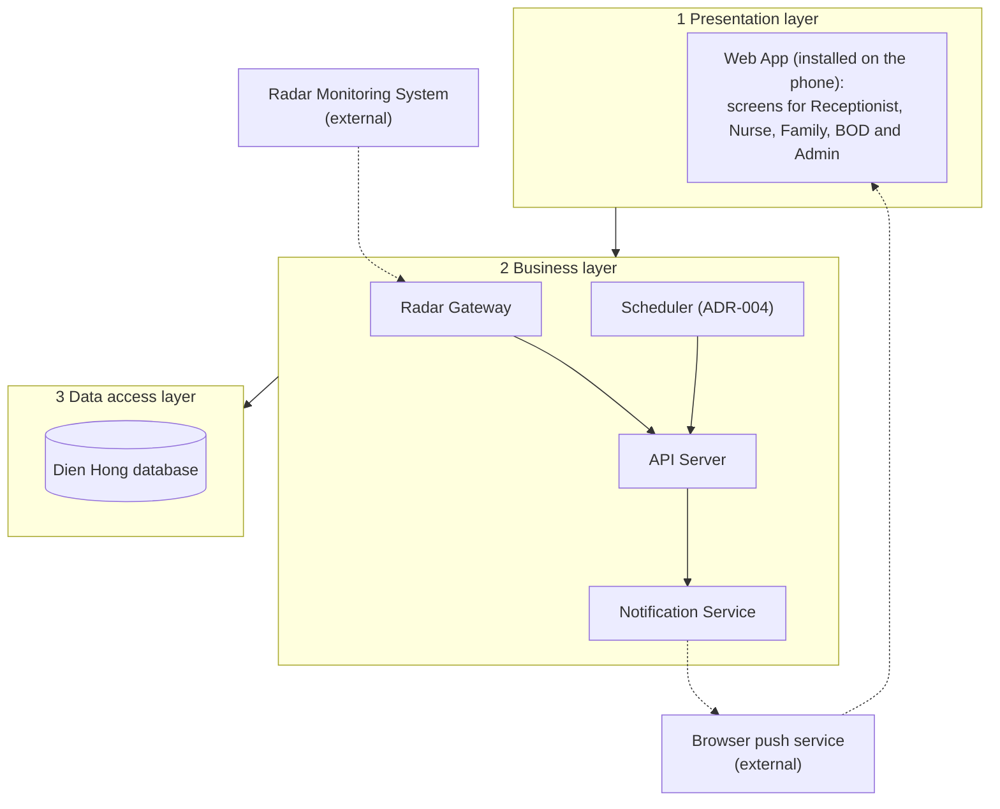

# Architecture: Dien Hong System

Lesson 4 (architectural design). The steps follow the design process of the lecture:
stakeholder requirements, system requirements, functional design, physical design, three layers.
Decisions are recorded as ADRs in [`adr/`](adr/).

| Field | Value |
|---|---|
| Version | v2 |
| Inputs | [CVCA](../context/cvca.md) (stakeholder requirements), [Context Diagram](../context/context-diagram.md), [Use Case Diagram](../use-case/use-case-diagram.md) |

## 1. System requirements

| ID | System requirement | From |
|---|---|---|
| SyR-01 | The system shall let the Receptionist create a resident profile and update resident information. | UC-01, UC-02 |
| SyR-02 | The system shall let a Nurse view a resident's profile and condition history. | UC-03, UC-04 |
| SyR-03 | The system shall let a Nurse record a resident's condition. | UC-05 |
| SyR-04 | The system shall receive monitoring signals from the radar, create an alert when a signal is abnormal according to the alert rules (fixed in the system), and notify the Nurse. | UC-06 |
| SyR-05 | The system shall notify the Nurse again when an alert is not acknowledged within 1 minute, and shall record a failure when it is still not acknowledged after the 3rd notice. | UC-06 |
| SyR-06 | The system shall send the Residents' Family one notice when an alert is dangerous and one more when the alert is closed. | UC-07 |
| SyR-07 | The system shall let the Residents' Family view the current condition of their resident. | UC-08 |
| SyR-08 | The system shall let the Residents' Family and the Nurses exchange messages. | UC-09 |
| SyR-09 | The system shall let the BOD view reports. | UC-10 |
| SyR-10 | The system shall let the Admin set up accounts and assign role-based permissions. | UC-11, UC-12 |
| SyR-11 | The system shall let the Admin monitor the radar status and view access and action logs. | UC-13, UC-14 |

The detailed, testable version of each requirement is an EARS row in
[W1](../function-list/w1-function-list.md).

## 2. Functional design

The system requirements divided into subordinate functions. Every requirement is served by at
least one function, and every function serves at least one requirement.

| Function | Serves |
|---|---|
| Identify the user and check the role permission | all |
| Save, update and show resident profiles | SyR-01, SyR-02 |
| Save and list the condition of a resident | SyR-02, SyR-03, SyR-07 |
| Receive radar signals and show radar device status | SyR-04, SyR-11 |
| Create an alert from an abnormal signal | SyR-04 |
| Time the 1-minute wait, escalate, and record a failure after the 3rd notice | SyR-05 |
| Send push notices to the Nurse and the family | SyR-04, SyR-05, SyR-06 |
| Save and list messages | SyR-08 |
| Compute reports | SyR-09 |
| Manage accounts and roles | SyR-10 |
| Record and show access and action logs | SyR-11 |

## 3. Physical design

Each function allocated to an element of the system. These elements are the lifelines of the
sequence diagrams in the [Use Case Diagram](../use-case/use-case-diagram.md).

Solid arrows run from layer to layer; dotted arrows go to or come from external systems. Inside
the business layer, the Radar Gateway passes radar data to the API Server, the Scheduler wakes
the API Server when an alert's wait ends, and the API Server asks the Notification Service to
send push notices. The push notice reaches the phone through the browser push service.

| Function | Element | Layer | Decision |
|---|---|---|---|
| Identify the user and check the role permission | API Server (checks the session token and the role on every request) | Business | ADR-003 |
| Save, update and show resident profiles | API Server | Business | |
| Save and list the condition of a resident | API Server | Business | |
| Receive radar signals and show radar device status | Radar Gateway, passes data to the API Server | Business, external | ADR-002 |
| Create an alert from an abnormal signal | API Server | Business | |
| Time the 1-minute wait, escalate, and record a failure after the 3rd notice | Scheduler starts the API Server | Business | ADR-004 |
| Send push notices to the Nurse and the family | Notification Service with Browser push service | Business, external | ADR-005 |
| Save and list messages | API Server | Business | |
| Compute reports | API Server | Business | |
| Manage accounts and roles | API Server | Business | |
| Record and show access and action logs | API Server | Business | |
| Keep residents, conditions, alerts, messages, accounts, roles and logs | Dien Hong database | Data access | |

All screens are elements of the presentation layer (Web App). Their data sources are the data
groups of W0.

## 4. Decisions

| ADR | Decision | Status |
|---|---|---|
| [ADR-001](adr/ADR-001-one-web-app.md) | One responsive web app for all users, installed on the phone, no native app | Accepted |
| [ADR-002](adr/ADR-002-radar-gateway.md) | Radar data comes in through a separate Radar Gateway | Accepted |
| [ADR-003](adr/ADR-003-role-check-every-request.md) | The API Server checks the session token and the role on every request | Accepted |
| [ADR-004](adr/ADR-004-scheduler.md) | Add a scheduler for the alert wait | Accepted (after Lesson 7) |
| [ADR-005](adr/ADR-005-push-notification.md) | Send alerts as push notices to the web app on the phone | Accepted (after Lesson 7) |

## Change log

| Version | When | Change | Why |
|---|---|---|---|
| v1 | Lesson 4 | Web App, API Server, Radar Gateway, Notification Service, database | First version based on the Use Case Diagram and the Context Diagram |
| v2 | Lesson 7 | Added Scheduler and the external Browser push service; split the escalation rule into SyR-05 | The alert rule needs a 1-minute wait that starts by itself (ADR-004), and family and Nurse notices go out as push notices to the web app (ADR-005); see the Inputs check in [activity-index](../activity/activity-index.md) |
