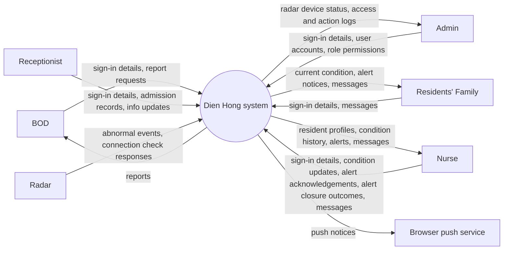

# Context Diagram: Dien Hong system

Dien Hong system is one black box in the middle; around it are the external entities it
exchanges data with. The Context Diagram answers "what does the system interact with?".

| Field | Value |
|---|---|
| Version | v4 |
| Built from | [CVCA](cvca.md): every stakeholder that exchanges information with the Dien Hong system; checked against the [Use Case Diagram](../use-case/use-case-diagram.md) |

## Diagram

The push notices for the Nurse and the family travel through the Browser push service to the
Web App on their phones. When a Nurse handles an alert, the Nurse sends the closure outcome to
the Dien Hong system; the system records it and closes the alert before sending a closure notice
to the family (if the first notice was sent).
Every user sends sign-in details (account and password) before using the system; this is the platform function FR-00-01 and has no use case of its own.

## Data crossing the boundary

| External entity | Sends to the system | Receives from the system | Use cases |
|---|---|---|---|
| BOD | Sign-in details, Report requests | Reports | UC-10 |
| Receptionist | Sign-in details, Admission records, info updates | (none) | UC-01, UC-02 |
| Admin | Sign-in details, User accounts, role permissions | Radar device status, access and action logs | UC-11, UC-12, UC-13, UC-14 |
| Residents' Family | Sign-in details, Messages | Current condition, alert notices, messages | UC-07, UC-08, UC-09 |
| Radar | Abnormal events, connection check responses | (none) | UC-06, UC-13 |
| Nurse | Sign-in details, Condition updates, alert acknowledgements, alert closure outcomes, messages | Resident profiles, condition history, alerts, messages | UC-03, UC-04, UC-05, UC-06, UC-09 |
| Browser push service | (none) | Push notices | UC-06, UC-07 |

## Change log

| Version | Change | Why |
|---|---|---|
| v1 | First version: BOD, Receptionist, System admin, Residents' Family, Radar Monitoring System, Nurses | |
| v2 | Added Browser push service; removed the "alert rules" flow from the Admin (alert rules are fixed in the system); BOD now receives reports; added alerts and acknowledgements for the Nurse; revised the actor names | Lesson 7 inputs check |
| v3 | Added Nurse-to-system flow for alert closure outcomes | Clarified that the Nurse reports the outcome when closing an alert in UC-06 |
| v4 | Added “sign-in details” to the flows from every user | FR-00-01 Sign in traces to “Context: all user entities |
