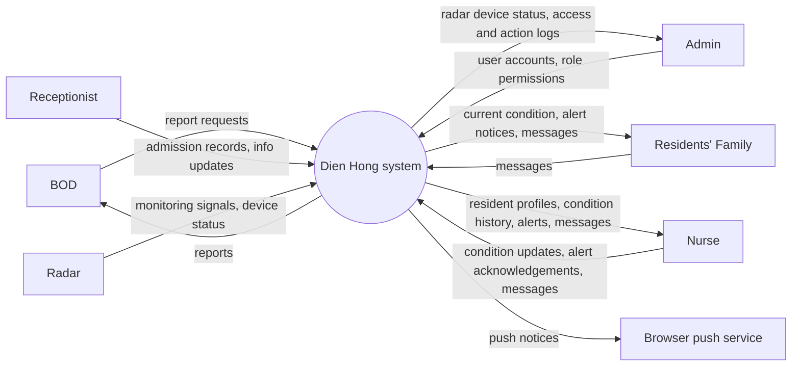

# Context Diagram: Dien Hong system

Dien Hong system is one black box in the middle; around it are the external entities it
exchanges data with. The Context Diagram answers "what does the system interact with?".

| Field | Value |
|---|---|
| Version | v2 |
| Built from | [CVCA](cvca.md): every stakeholder that exchanges information with the Dien Hong system; checked against the [Use Case Diagram](../use-case/use-case-diagram.md) |

## Diagram

The push notices for the Nurse and the family travel through the Browser push service to the
Web App on their phones.

## Data crossing the boundary

| External entity | Sends to the system | Receives from the system | Use cases |
|---|---|---|---|
| BOD | Report requests | Reports | UC-10 |
| Receptionist | Admission records, info updates | (none) | UC-01, UC-02 |
| Admin | User accounts, role permissions | Radar device status, access and action logs | UC-11, UC-12, UC-13, UC-14 |
| Residents' Family | Messages | Current condition, alert notices, messages | UC-07, UC-08, UC-09 |
| Radar | Monitoring signals, device status | (none) | UC-06, UC-13 |
| Nurse | Condition updates, alert acknowledgements, messages | Resident profiles, condition history, alerts, messages | UC-03, UC-04, UC-05, UC-06, UC-09 |
| Browser push service | (none) | Push notices | UC-06, UC-07 |

## Change log

| Version | Change | Why |
|---|---|---|
| v1 | First version: BOD, Receptionist, System admin, Residents' Family, Radar Monitoring System, Nurses | |
| v2 | Added Browser push service; removed the "alert rules" flow from the Admin (alert rules are fixed in the system); BOD now receives reports; added alerts and acknowledgements for the Nurse; replaced "care requests", "announcements", "request updates", "shift handover" and "backup/restore" with the flows of the use cases; names unified (Admin, Radar, Nurse); added the Use cases column | Every flow must belong to a use case, and the alert is pushed to phones (ADR-005) |
