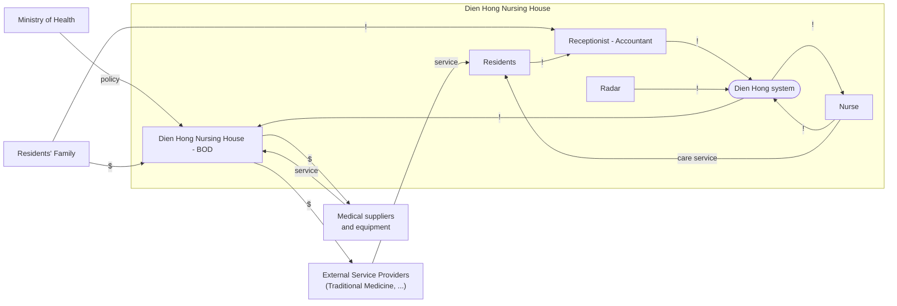

# CVCA: Dien Hong

The Customer Value Chain Analysis lists every stakeholder of the Dien Hong Nursing House and
what flows between them: money (`$`), information (`!`) and goods or services. It is drawn before
the system is designed, to find the problems and opportunities.

| Field | Value |
|---|---|
| Version | v1.0 |
| Next | [Context Diagram](context-diagram.md) |

## 1. Value chain (with the new system)

The dashed box is the Dien Hong Nursing House. Everything outside it is an outside stakeholder.

## Legend

| Symbol | Meaning |
|---|---|
| `!` | Resident information, care updates, task status, request, bookings |
| `$` | Money |
| Service | Care service, policy |
