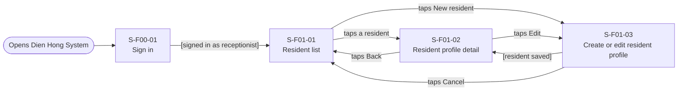
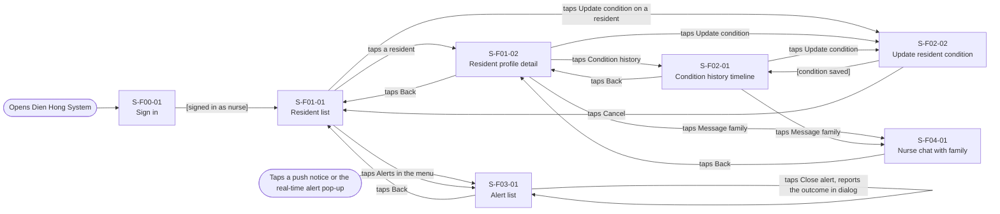
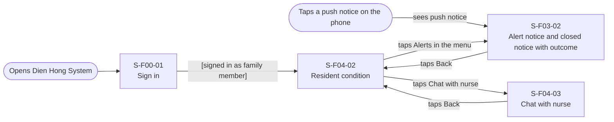
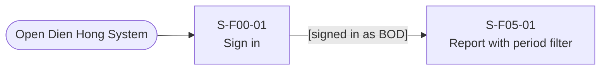
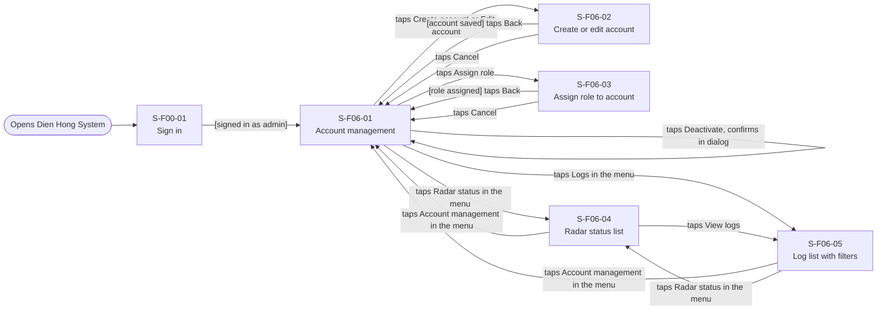

# Screen Transition Diagram: Dien Hong System

## 1. Receptionist

## 2. Nurse

## 3. Residents' Family

## 4. BOD

## 5. Admin

## Checks

- Every screen in the Screen List appears: yes (17 of 17).
- Every screen reachable from an entry point: yes.
- No dead ends: yes.
- Usage-flow paths: every "UC-a to UC-b" arrow of [usage-flow.md](usage-flow.md) has a path.
- Sign in is shared.
- A refused request (access denied) sends the user back to the home screen of their role with a message (FR-06-03). 

## Usage-flow paths

| Actor             | Usage-flow arrow | Path on this diagram                                                                                                                                                                     |
| ----------------- | ---------------- | ---------------------------------------------------------------------------------------------------------------------------------------------------------------------------------------- |
| Nurse             | UC-03 to UC-04   | S-F01-02 Resident profile detail → S-F02-01 Condition history timeline ("taps Condition history")                                                                                        |
| Nurse             | UC-04 to UC-05   | S-F02-01 Condition history timeline → S-F02-02 Update resident condition ("taps Update condition")                                                                                       |
| Nurse             | UC-04 to UC-09   | S-F02-01 Condition history timeline → S-F04-01 Nurse chat with family ("taps Message family")                                                                                            |
| Residents' Family | UC-08 to UC-09   | S-F04-02 Resident condition → S-F04-03 Chat with nurse ("taps Chat with nurse")                                                                                                          |
| Admin             | UC-11 to UC-12   | S-F06-02 Create or edit account → S-F06-01 Account management ("[account saved] taps Back") → S-F06-03 Assign role to account ("taps Assign role"); S-F06-01 serves both UC-11 and UC-12 |
| Admin             | UC-14 to UC-12   | S-F06-05 Log list with filters → S-F06-01 Account management ("taps Account management in the menu") → S-F06-03 Assign role to account ("taps Assign role")                              |
| Admin             | UC-13 to UC-14   | S-F06-04 Radar status list → S-F06-05 Log list with filters ("taps View logs")                                                                                                           |

