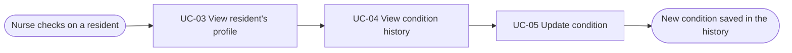
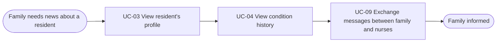
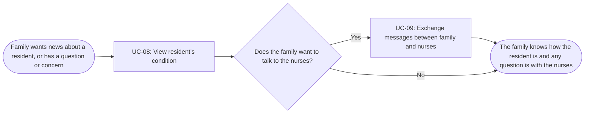
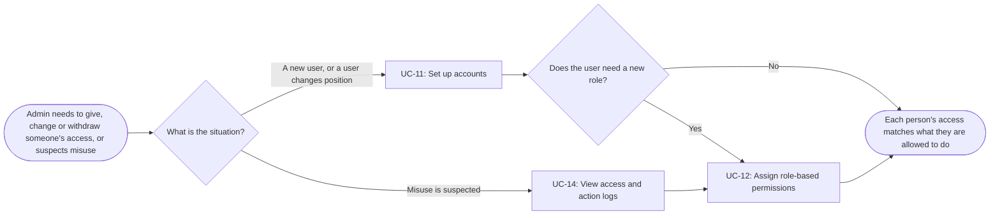
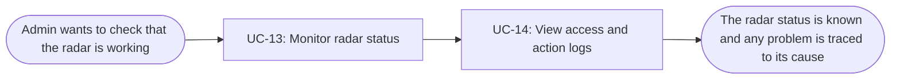

# Usage Flow: Dien Hong System

| Field   | Value                                                                                |
| ------- | ------------------------------------------------------------------------------------ |
| Product | Dien Hong System                                                                     |
| Version | v0.1                                                                                 |
| Date    | 2026-11-06                                                                           |
| Sources | W0 Table 1 (use case inventory); Use Case Diagram; `docs/activity/activity-index.md` |
|         |                                                                                      |

## Receptionist: manage resident profile

| Step | Use case                           | Activity diagram | Screens |
| ---- | ---------------------------------- | ---------------- | ------- |
| 1    | UC-01 Create new resident profile  | `AD-UC-01.md`    |         |
| 2    | UC-02 Update resident information  | `AD-UC-02(1).md` |         |

## Nurse: keep a resident's condition up to date

  

| Step | Use case                      | Activity diagram | Screens |
| ---- | ----------------------------- | ---------------- | ------- |
| 1    | UC-03 View resident's profile | `not needed`     |         |
| 2    | UC-04 View condition history  | `not needed`     |         |
| 3    | UC-05 Update condition        | `AD-UC-05.md`    |         |
## Nurse: keep a resident's family informed

  

| Step | Use case                                          | Activity diagram | Screens |
| ---- | ------------------------------------------------- | ---------------- | ------- |
| 1    | UC-03 View resident's profile                     | `not needed`     |         |
| 2    | UC-04 View condition history                      | `not needed`     |         |
| 3    | UC-09 Exchange messages between family and nurses | `AD-UC-09.md`    |         |

## Residents' Family: stay informed about a resident

| Step | Use case                                           | Activity diagram | Screens                    |
| ---- | -------------------------------------------------- | ---------------- | -------------------------- |
| 1    | UC-08 View resident's condition                    | `AD-UC-08.md`    | TBD: no screen-list.md yet |
| 2    | UC-09 Exchange messages between family and nurses  | `AD-UC-09.md`    | TBD: no screen-list.md yet |

## BOD: see how the nursing home is running

| Step | Use case           | Activity diagram | Screens |
| ---- | ------------------ | ---------------- | ------- |
| 1    | UC-10 View reports | `not needed`     |         |

## Admin: manage account access

| Step | Use case                            | Activity diagram | Screens (fill in after Block 2) |
| ---- | ----------------------------------- | ---------------- | ------------------------------- |
| 1    | UC-11 Set up accounts               | `AD-UC-11.md`    |                                 |
| 2    | UC-14 View access and action logs   | `not needed`     |                                 |
| 3    | UC-12 Assign role-based permissions | `AD-UC-12.md`    |                                 |

## Admin: keep the radar working

| Step | Use case                          | Activity diagram | Screens (fill in after Block 2) |
| ---- | --------------------------------- | ---------------- | ------------------------------- |
| 1    | UC-13 Monitor radar status        | `AD-UC-13.md`    |                                 |
| 2    | UC-14 View access and action logs | `not needed`     |                                 |

## Use cases without a flow

| Use case | Started by | Described in  |
| -------- | ---------- | ------------- |
| UC-06    | Radar      | `AD-UC-06.md` |
| UC-07    | Radar      | `AD-UC-07.md` |

## Checks before you save

- [x] Every actor that starts a use case has at least one flow.
- [x] An actor with clearly different goals has one flow per goal; no flow has more than about
      9 boxes.
- [x] Every actor name matches the Use Case Diagram and the Context Diagram.
- [x] Coverage: every in-scope use case of W0 Table 1 (Must, Should, Could) that a person starts
      appears in at least one flow, with the same ID and name. A use case may appear in several
      flows. Use cases started by time or an external system are listed under "Use cases without
      a flow". Won't-have use cases appear nowhere.
- [x] No box is a click or a screen; no box tells two use cases.
- [x] Every flow renders on mermaid.live.
- [ ] After Block 2: every step has at least one screen, and every screen in the screen list
      appears in some step.

