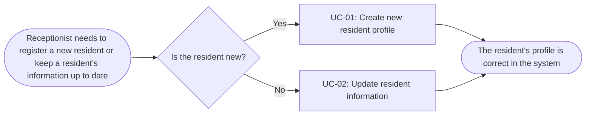
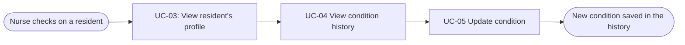
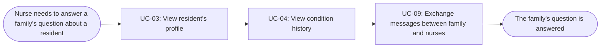
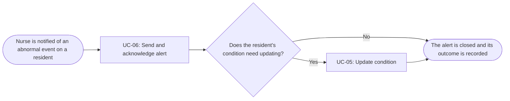
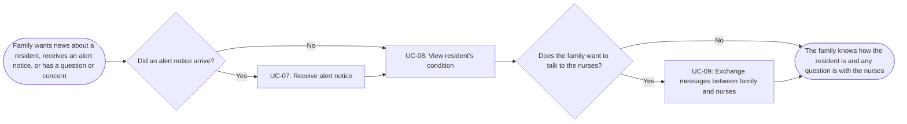
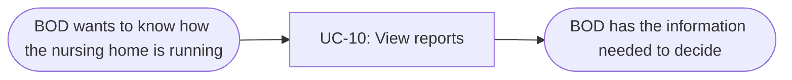
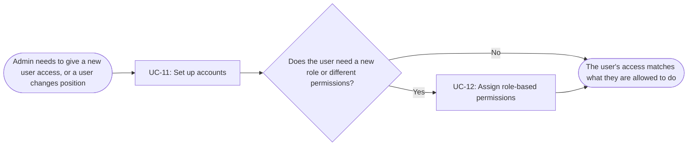
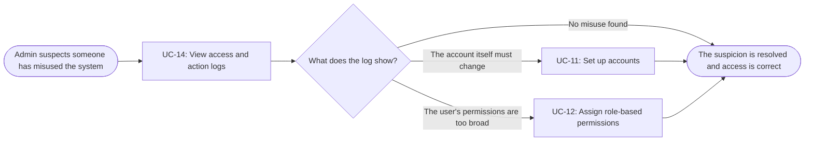
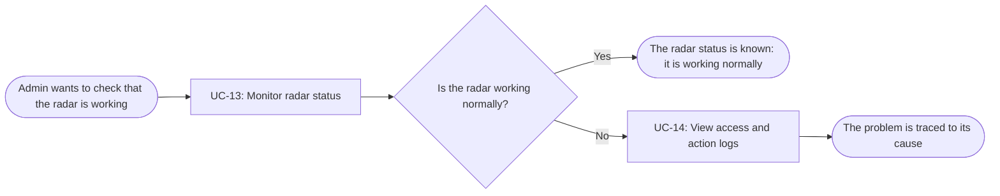

# Usage Flow: Dien Hong System

| Field   | Value                                                                                |
| ------- | ------------------------------------------------------------------------------------ |
| Product | Dien Hong System                                                                     |
| Version | v0.1                                                                                 |
| Date    | 2026-11-06                                                                           |
| Sources | W0 Table 1 (use case inventory); Use Case Diagram; `docs/activity/activity-index.md` |
|         |                                                                                      |

## Receptionist: manage resident profile

| Step | Use case                           | Activity diagram | Screens |
| ---- | ---------------------------------- | ---------------- | ------- |
| 1    | UC-01 Create new resident profile  | `AD-UC-01.md`    |   	S-F01-01, S-F01-02, S-F01-03     |
| 2    | UC-02 Update resident information  | `AD-UC-02.md` |  S-F01-02, S-F01-03       |

## Nurse: keep a resident's condition up to date

| Step | Use case                      | Activity diagram | Screens |
| ---- | ----------------------------- | ---------------- | ------- |
| 1    | UC-03 View resident's profile | `not needed`     |  	S-F01-01, S-F01-02       |
| 2    | UC-04 View condition history  | `not needed`     | 	S-F02-01        |
| 3    | UC-05 Update condition        | `AD-UC-05.md`    |  	S-F02-02       |

## Nurse: answer a family's question

| Step | Use case                                          | Activity diagram | Screens            |
| ---- | ------------------------------------------------- | ---------------- | ------------------ |
| 1    | UC-03 View resident's profile                     | `not needed`     | S-F01-01, S-F01-02 |
| 2    | UC-04 View condition history                      | `not needed`     | S-F02-01           |
| 3    | UC-09 Exchange messages between family and nurses | `AD-UC-09.md`    | S-F04-01           |

## Nurse: respond to an alert

| Step | Use case                         | Activity diagram | Screens |
| ---- | -------------------------------- | ---------------- | ------- |
| 1    | UC-06 Send and acknowledge alert | `AD-UC-06.md`    | S-F03-01   |
| 2    | UC-05 Update condition (only if the condition changed) | `AD-UC-05.md` | S-F02-02 |

## Residents' Family: stay informed about a resident

| Step | Use case                                                    | Activity diagram | Screens  |
| ---- | ----------------------------------------------------------- | ---------------- | -------- |
| 1    | UC-07 Receive alert notice (only if an alert arrived)       | `AD-UC-07.md`    |  S-F03-02 |
| 2    | UC-08 View resident's condition                             | `AD-UC-08.md`    | S-F04-02 |
| 3    | UC-09 Exchange messages between family and nurses (optional) | `AD-UC-09.md`   | S-F04-03 |

## BOD: see how the nursing home is running

| Step | Use case           | Activity diagram | Screens |
| ---- | ------------------ | ---------------- | ------- |
| 1    | UC-10 View reports | `not needed`     |  S-F05-01       |

## Admin: give or change someone's access

| Step | Use case                                                  | Activity diagram | Screens            |
| ---- | --------------------------------------------------------- | ---------------- | ------------------ |
| 1    | UC-11 Set up accounts                                     | `AD-UC-11.md`    | S-F06-01, S-F06-02 |
| 2    | UC-12 Assign role-based permissions (only if role changes) | `AD-UC-12.md`   | S-F06-01, S-F06-03 |

## Admin: investigate suspected misuse

| Step | Use case                                                   | Activity diagram | Screens            |
| ---- | ---------------------------------------------------------- | ---------------- | ------------------ |
| 1    | UC-14 View access and action logs                          | `not needed`     | S-F06-05           |
| 2a   | UC-11 Set up accounts (if the account must change)         | `AD-UC-11.md`    | S-F06-01, S-F06-02 |
| 2b   | UC-12 Assign role-based permissions (if permissions change) | `AD-UC-12.md`   | S-F06-01, S-F06-03 |                            |

## Admin: keep the radar working

| Step | Use case                          | Activity diagram | Screens (fill in after Block 2) |
| ---- | --------------------------------- | ---------------- | ------------------------------- |
| 1    | UC-13 Monitor radar status        | `AD-UC-13.md`    |     	S-F06-04                            |
| 2    | UC-14 View access and action logs | `not needed`     |       	S-F06-05                          |

## Use cases without a flow

| Use case | Started by | Described in  |
| -------- | ---------- | ------------- |
| UC-06 Send and acknowledge alert   | Radar, when it detects an abnormal event      | `AD-UC-06.md` |
| UC-07 Receive alert notice   | Radar, through a dangerous alert of UC-06     | `AD-UC-07.md` |

S-F00-01 Sign in is shared by every flow above: each actor passes through it before the first step.

## Checks before you save

- [x] Every actor that starts a use case has at least one flow.
- [x] An actor with clearly different goals has one flow per goal; no flow has more than about
      9 boxes.
- [x] Every actor name matches the Use Case Diagram and the Context Diagram.
- [x] Coverage: every in-scope use case of W0 Table 1 (Must, Should, Could) that a person starts
      appears in at least one flow, with the same ID and name. A use case may appear in several
      flows. Use cases started by time or an external system are listed under "Use cases without
      a flow". Won't-have use cases appear nowhere.
- [x] No box is a click or a screen; no box tells two use cases.
- [x] Every flow renders on mermaid.live.
- [x] After Block 2: every step has at least one screen, and every screen in the screen list
      appears in some step.

