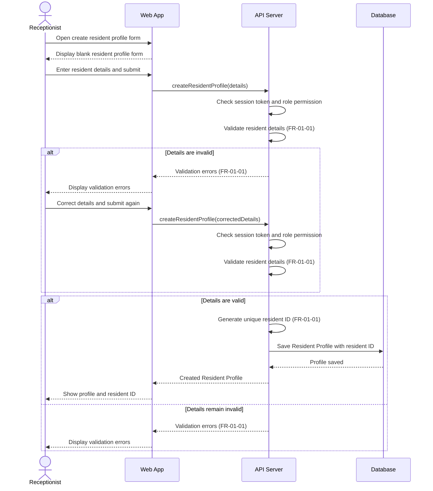

# Sequence Diagram: SD-UC-01 Create new resident profile

| Field | Value |
|---|---|
| Use case | UC-01 Create new resident profile |
| Version | v1 |
| FRs | FR-01-01 |

The lifelines follow the Dien Hong use-case diagram's sequence-diagram guidance: Web App, API Server and Database. The API Server's session-token and role-permission check is shown based on the project-wide assumption for use cases that require login; it is not labelled as FR-06-03 because that FR is scoped to UC-11, UC-12 and UC-13.

## Reading notes

- The `alt` fragments represent system validation outcomes, not choices made by the receptionist.
- The retry is shown after an invalid submission; the next submission is validated again.
- The supplied requirements do not define the required-field list or detailed validation rules. No field-level rules are added here.
- The exact ID-generation algorithm and database constraint are not specified; the diagram shows only the required outcome: a unique resident ID.
