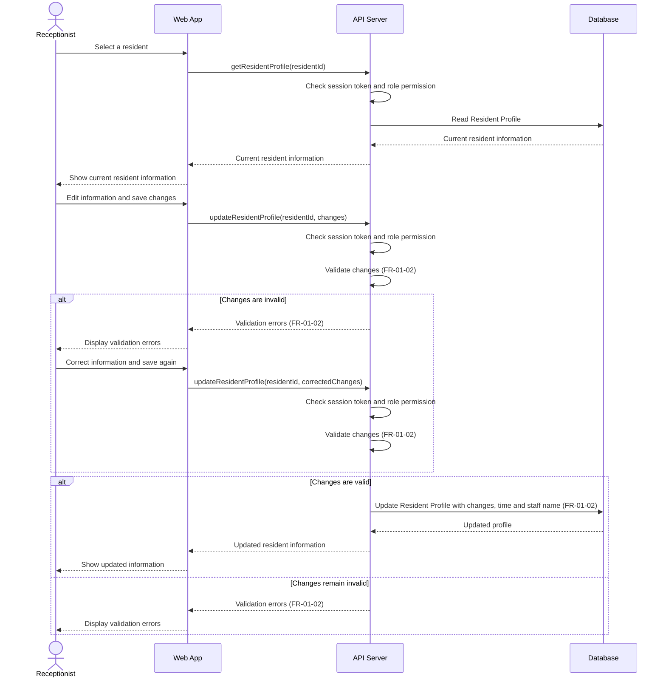

# Sequence Diagram: SD-UC-02 Update resident information

| Field | Value |
|---|---|
| Use case | UC-02 Update resident information |
| Version | v1 |
| FRs | FR-01-02 |

The lifelines follow the Dien Hong use-case diagram's sequence-diagram guidance: Web App, API Server and Database. The API Server's session-token and role-permission check is shown based on the project-wide assumption for use cases that require login; it is not labelled as FR-06-03 because that FR is scoped to UC-11, UC-12 and UC-13.

## Reading notes

- The diagram follows AD-UC-02: select resident, show current information, edit, save, validate, then either display errors or store the changes and show the updated information.
- The `alt` fragments represent validation outcomes decided by the system.
- The supplied sources do not enumerate which fields may be updated or the detailed validation rules.
- The exact timestamp format and audit-retention rule are not specified; the diagram retains the stated requirement to store the time and staff name.
