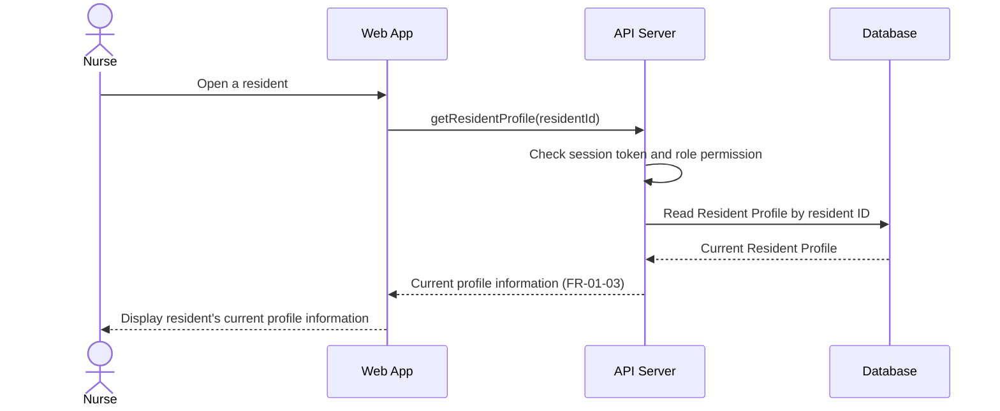

# Sequence Diagram: SD-UC-03 View resident's profile

| Field | Value |
|---|---|
| Use case | UC-03 View resident's profile |
| Version | v1 |
| FRs | FR-01-03 |

The lifelines follow the Dien Hong use-case diagram's sequence-diagram guidance: Web App, API Server and Database. The API Server's session-token and role-permission check is shown based on the project-wide assumption for use cases that require login; it is not labelled as FR-06-03 because that FR is scoped to UC-11, UC-12 and UC-13.

## Reading notes

- The interaction is based on FR-01-03: when the nurse opens a resident, the system displays the resident's current profile information.
- The `residentId` is the identifier for the resident opened by the nurse; the supplied FR does not specify how the nurse searches for or selects that resident.
- The supplied requirements do not define a not-found response or additional profile fields, so neither is added as a separate branch.
