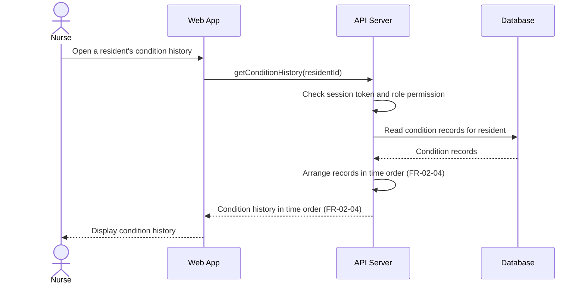

# Sequence Diagram: SD-UC-04 View condition history

| Field | Value |
|---|---|
| Use case | UC-04 View condition history |
| Version | v1 |
| FRs | FR-02-04 |

The lifelines follow the Dien Hong use-case diagram's sequence-diagram guidance: Web App, API Server and Database. The API Server's session-token and role-permission check is shown based on the project-wide assumption for use cases that require login; it is not labelled as FR-06-03 because that FR is scoped to UC-11, UC-12 and UC-13.

## Reading notes

- The interaction is based on FR-02-04: when a nurse opens a resident's condition history, the system lists all condition records in time order.
- The source says “in time order” but does not specify ascending or descending order. The diagram therefore does not impose either direction.
- The supplied requirements do not specify pagination, filters, or the response when no condition records exist; these behaviours are not added.
