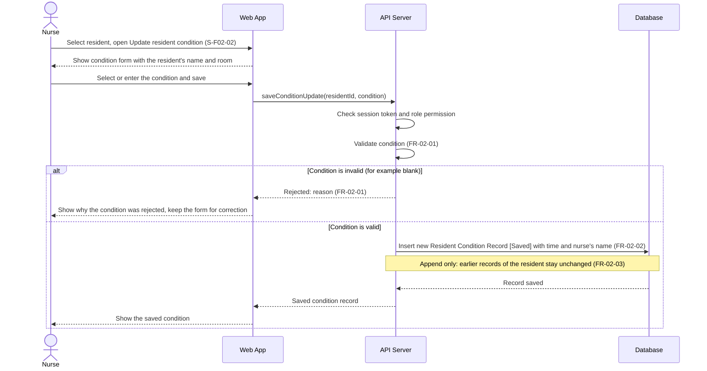

# Sequence Diagram: SD-UC-05 Update condition

Analysis level: how the parts of the Dien Hong System talk to each other when a Nurse records a
resident's condition. The lifelines are the elements of the
[physical design](../architecture/architecture.md). The nurse's choices (which resident, which
condition, whether to correct and save again after a rejection) are shown in the activity diagram
[AD-UC-05](../activity/AD-UC-05.md), not here.

| Field | Value |
|---|---|
| Use case | UC-05 Update condition |
| Version | v1 |
| FRs | FR-02-01, FR-02-02, FR-02-03 |

The `alt` fragment is an outcome decided inside the system (FR-02-01), so it belongs in a sequence
diagram. Correcting the condition and saving again is the nurse's choice (`a3` and the merge `m1`
in AD-UC-05): it repeats the exchange from "Select or enter the condition and save" and is not
drawn as a second fragment.

## Reading notes

- The repository holds design documents only, no source code (checked at commit `e918b23`,
  14/11/2026). The flow follows AD-UC-05, W1 (FR-02-01 to FR-02-03 and their L3 work items) and
  the Screen List. `saveConditionUpdate` is an analysis-level name taken from the W1 work item
  FR-02-02-BE "API: save condition update"; it is not a verified endpoint.
- Validation runs on the API Server: FR-02-01-BE holds the rule, FR-02-02-FE only shows the
  message ("The condition is empty. Enter the condition and save again.", UI Conventions).
- In the invalid branch nothing reaches the Database, so earlier records stay unchanged
  (AD-UC-05 failure end state).
- Every valid save inserts one new record (BR-02-01); this record is what UC-04 lists and UC-08
  shows to the family.
- The session-token and role-permission check follows the project-wide assumption (ADR-003), as
  in SD-UC-01 to SD-UC-04.

## Not verified or not specified

| Item | What the sources say | Drawn? |
|---|---|---|
| Invalid condition values | Only "blank" is given (FR-02-01-BE); the allowed values are not listed (AD-UC-05 open question 1) | Only the blank case is named |
| List of conditions to "select" | W1 does not define a list, so no call loads one | No |
| Loading the resident's name and room on S-F02-02 | Not said whether the Web App reads them again from the API Server or reuses the resident list (S-F01-01) | No API call drawn |
| Resident not found | No FR | No |
| Access denied (FR-06-03) | FR-06-03 is scoped to UC-11, UC-12 and UC-13 | No, as in SD-UC-01 to SD-UC-04 |
| Screen after a valid save | Screen Transition gives two targets, S-F01-02 and S-F02-01, for the same event "taps Save [condition valid]" | Shown only as "Show the saved condition" |
| Action log entry (ADR-003, FR-06-13) | Written on every request | No, as in SD-UC-01 to SD-UC-04 |
