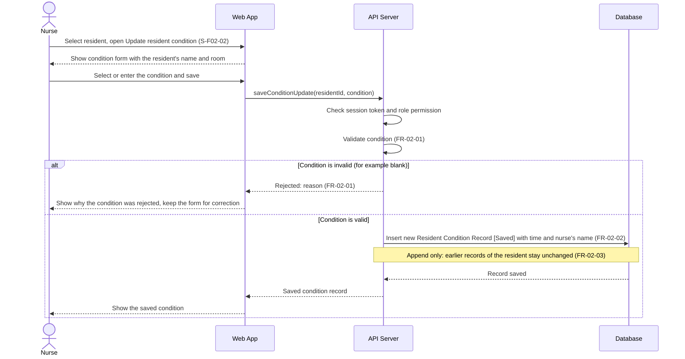

# Sequence Diagram: SD-UC-05 Update condition

Analysis level: how the parts of the Dien Hong System talk to each other when a Nurse records a
resident's condition. The lifelines are the elements of the
[physical design](../architecture/architecture.md). The nurse's choices (which resident, which
condition, whether to correct and save again after a rejection) are shown in the activity diagram
[AD-UC-05](../activity/AD-UC-05.md), not here.

| Field | Value |
|---|---|
| Use case | UC-05 Update condition |
| Version | v1 |
| FRs | FR-02-01, FR-02-02, FR-02-03 |

The `alt` fragment is an outcome decided inside the system (FR-02-01), so it belongs in a sequence
diagram. Correcting the condition and saving again is the nurse's choice (`a3` and the merge `m1`
in AD-UC-05): it repeats the exchange from "Select or enter the condition and save" and is not
drawn as a second fragment.

