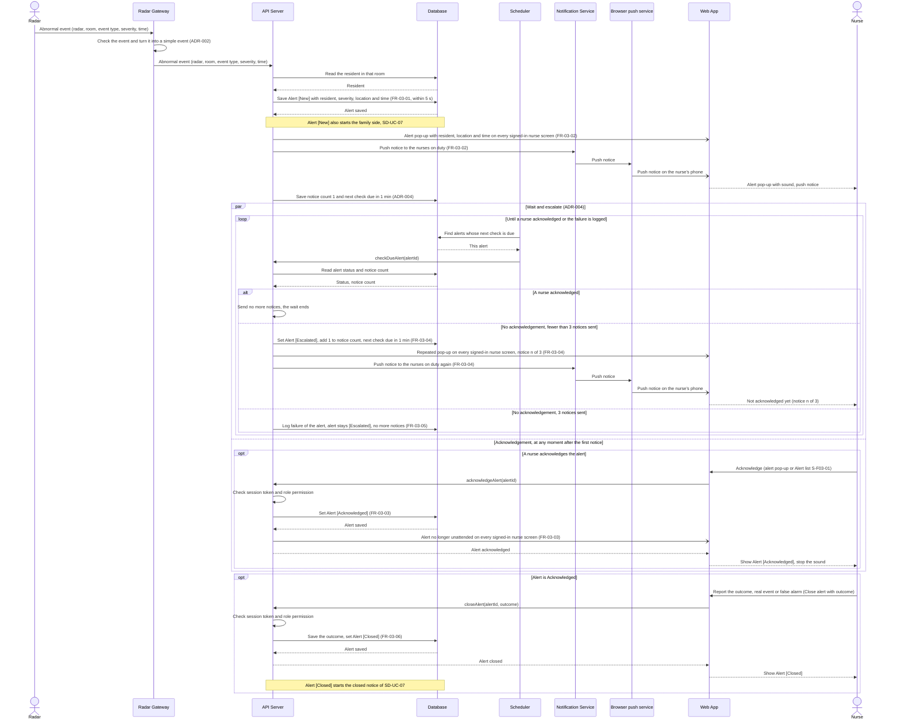

# Sequence Diagram: SD-UC-06 Send and acknowledge alert

Analysis level: how the parts of the Dien Hong System talk to each other from the moment the Radar
reports an abnormal event until a Nurse closes the alert, or until the failure is logged after the
third unacknowledged notice. The lifelines are the elements of the
[physical design](../architecture/architecture.md), including the Scheduler (ADR-004) and the
Browser push service (ADR-005). The nurse's actions (acknowledge, handle, report the outcome) are
shown in the activity diagram [AD-UC-06](../activity/AD-UC-06.md). The notices to the family are a
separate use case, [SD-UC-07](SD-UC-07.md).

| Field | Value |
|---|---|
| Use case | UC-06 Send and acknowledge alert |
| Version | v1 |
| FRs | FR-03-01 to FR-03-06; FR-03-08 (non-functional, see notes); FR-03-07 not drawn |

The `alt` fragment inside the loop is decided by the system when the 1-minute wait ends (`d1` and
`d3` in AD-UC-06, same guards), so it belongs in a sequence diagram. The `par` fragment shows that
the two operands interleave: the Scheduler's rounds run on their own, and a nurse may acknowledge
during any round. Acknowledging and closing are the nurse's actions, so they appear as `opt`
(they may not happen: the failure end state has no acknowledgement), never as a system `alt`.

