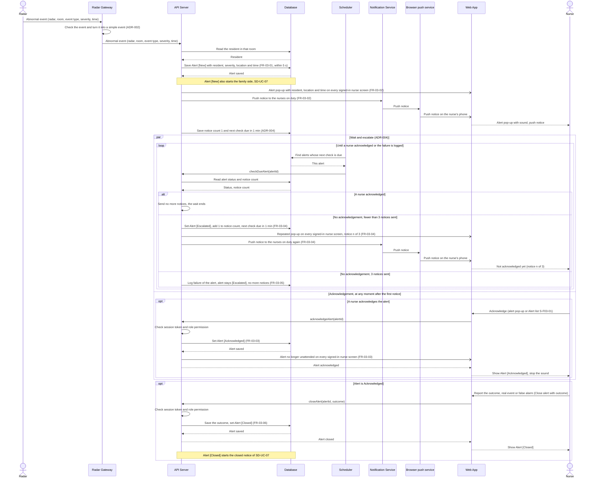

# Sequence Diagram: SD-UC-06 Send and acknowledge alert

Analysis level: how the parts of the Dien Hong System talk to each other from the moment the Radar
reports an abnormal event until a Nurse closes the alert, or until the failure is logged after the
third unacknowledged notice. The lifelines are the elements of the
[physical design](../architecture/architecture.md), including the Scheduler (ADR-004) and the
Browser push service (ADR-005). The nurse's actions (acknowledge, handle, report the outcome) are
shown in the activity diagram [AD-UC-06](../activity/AD-UC-06.md). The notices to the family are a
separate use case, [SD-UC-07](SD-UC-07.md).

| Field | Value |
|---|---|
| Use case | UC-06 Send and acknowledge alert |
| Version | v1 |
| FRs | FR-03-01 to FR-03-06; FR-03-08 (non-functional, see notes); FR-03-07 not drawn |

The `alt` fragment inside the loop is decided by the system when the 1-minute wait ends (`d1` and
`d3` in AD-UC-06, same guards), so it belongs in a sequence diagram. The `par` fragment shows that
the two operands interleave: the Scheduler's rounds run on their own, and a nurse may acknowledge
during any round. Acknowledging and closing are the nurse's actions, so they appear as `opt`
(they may not happen: the failure end state has no acknowledgement), never as a system `alt`.

## Reading notes

- The repository holds design documents only, no source code (checked at commit `e918b23`,
  14/11/2026). The flow follows AD-UC-06, ADR-002, ADR-004, ADR-005, W1 (FR-03-01 to FR-03-08)
  and the Screen List. `checkDueAlert`, `acknowledgeAlert` and `closeAlert` are analysis-level
  names taken from the W1 work items FR-03-04-BE, FR-03-03-BE and FR-03-06-BE; they are not
  verified endpoints.
- Alert states are spelled as in AD-UC-06: New, Acknowledged, Escalated, Closed. Allowed changes:
  New or Escalated to Acknowledged, Acknowledged to Closed.
- "3 notices" counts the first notice (W5 open question 3, default yes). With the default, the
  failure is logged 1 minute after the third notice; the alert stays Escalated and open on the
  nurses' list (AD-UC-06 open question 2), so a nurse can still acknowledge it later.
- The Radar's built-in AI decides what is abnormal and the severity (ADR-002); the Radar Gateway
  is the only element that talks to the Radar.
- W0 marks UC-06 "Login required = No" because the Radar starts it. The nurse's own requests
  still go through the ADR-003 check (AD-UC-06 precondition: nurses are signed in).
- FR-03-08 (always on, restart after a failure) is a non-functional requirement with no message
  of its own; ADR-002 puts the Radar Gateway under it.
- Effective priorities (W4): FR-03-05 is Could, FR-03-07 is Should, the rest are Must.

## Not verified or not specified

| Item | What the sources say | Drawn? |
|---|---|---|
| FR-03-07 Group repeated radar events | "Left out for now" in AD-UC-06 v2.1 | No |
| How the pop-up reaches signed-in nurse screens | FR-03-02-BE says "real-time push to nurse screens", but the physical design has no element or channel for it (only API Server → Notification Service → Browser push service) | Drawn as a direct async message `API-)W`; the mechanism must be decided |
| Who is a "nurse on duty" | FR-03-02 and FR-03-04 send push notices to nurses on duty, but no data group in W0 Table 4 holds shifts or duty | The recipient group is named, not resolved |
| Event that fails the gateway's check | ADR-002 says the gateway checks each event but not what happens to a bad one | No |
| No resident in the room | Not specified (AD-UC-06 notes FR-03-01 needs room data from F-01) | No |
| Nurse push not delivered | No retry rule for nurses; ADR-005 relies on the in-app alert and the 1-minute rule | No |
| Two nurses acknowledge at once, or close a not-acknowledged alert | Not specified; FR-03-06 only covers an acknowledged alert | No |
| Acknowledgement time and nurse name | FR-05-01 (UC-10) needs the time from alert to acknowledgement and AD-UC-06 `s4` shows the nurse name, but W1 FR-03-03 states neither | Only "Set Alert [Acknowledged]" |
| Whether acknowledging clears the next check | ADR-004 does not say; the diagram shows the check that both designs need (`d1`) | No separate write |
| How often the Scheduler looks for due alerts | Not stated in ADR-004 | No |
| Radar keeps and resends events while the app is down | Open question (AD-UC-06 Q7, default: the radar resends) | No |
