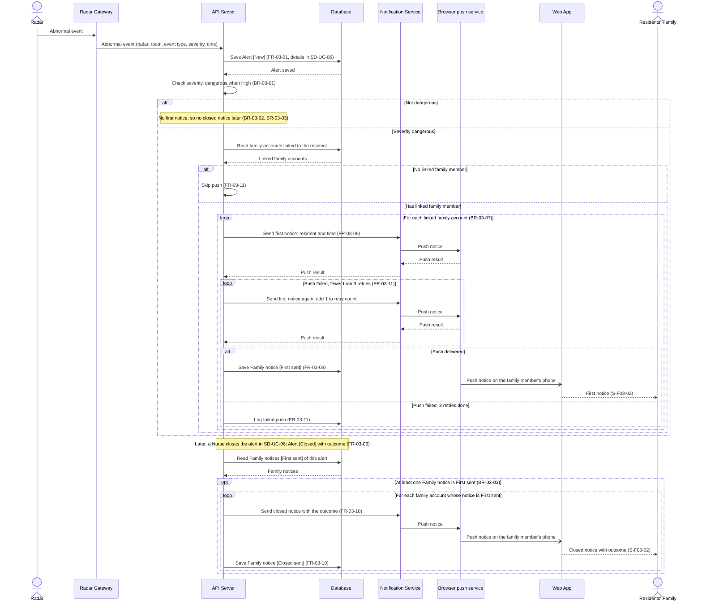

# Sequence Diagram: SD-UC-07 Receive alert notice

Analysis level: how the parts of the Dien Hong System talk to each other when a new alert is
dangerous and the Residents' Family must be told, and again when that alert is closed. The
lifelines are the elements of the [physical design](../architecture/architecture.md). This is the
family side only; the nurse side of the same alert is [SD-UC-06](SD-UC-06.md), and the two meet
through the state of the `Alert` (New, Closed), as in the activity diagram
[AD-UC-07](../activity/AD-UC-07.md). Business rules: BR-03-01 to BR-03-05,
BR-03-07.

| Field | Value |
|---|---|
| Use case | UC-07 Receive alert notice |
| Version | v1 |
| FRs | FR-03-09, FR-03-10, FR-03-11 |

Every `alt` here is decided inside the system: the severity (`d2`), the linked family member
(`d5`) and the push result (`d6`) of AD-UC-07, with the same guards and `n = 3` from W1
FR-03-11. The family does not choose anything in this use case; it only receives.

## Reading notes

- The repository holds design documents only, no source code (checked at commit `e918b23`,
  14/11/2026). The flow follows AD-UC-07, ADR-005, W1 (FR-03-09 to FR-03-11 and their L3 work
  items), the business rules in W0 and the Screen List.
- The first three messages repeat the start of SD-UC-06 so that the diagram starts in the Radar,
  like AD-UC-07. The nurse notices of the same alert run at the same time and are not repeated
  here.
- Only a dangerous alert gets a first notice, once per family account. Acknowledged and Escalated
  states, and the repeated nurse notices, send nothing to the family (AD-UC-07).
- Family notice states are spelled as in AD-UC-07: First sent, Closed sent.
- Defaults applied from the open questions: all linked family members get the notice (BR-03-07);
  a failed push is retried only for the member whose push failed (AD-UC-07 Q7); the closed notice
  shows the outcome (Q2).
- Effective priorities (W4): FR-03-09 is Must; FR-03-10 and FR-03-11 are Could, so the retry loop
  and the closed-notice part may be cut if time runs out.

## Not verified or not specified

| Item | What the sources say | Drawn? |
|---|---|---|
| What "push delivered" means | The Notification Service only gets the Browser push service's answer (accepted or failed); ADR-005 says a push is never guaranteed to reach the phone | The guard keeps the AD-UC-07 wording; it can only mean "accepted by the push service" |
| Who waits between two retries, and how long | W5 Q7 default is 1 minute, but ADR-004 gives the Scheduler only the nurse alert wait; no element times a family retry | Retries drawn without a timer |
| No linked family member: log or not | FR-03-11 says only "skip the push"; the AD-UC-07 acceptance test says "logged or noted" | Skip only |
| Retry rules for the closed notice | AD-UC-07 Q6 default: same rules, not drawn separately | No |
| Recipients of the closed notice | W1 FR-03-10 says "the linked family accounts" at alert level; the Family notice states in AD-UC-07 are per notice | Per account whose notice is First sent; align the W1 wording |
| Push subscription of the family's phone | ADR-005 requires the family to install the web app and allow notices once, but no flow stores the subscription | No |
| Opening S-F03-02 from the menu to read past notices | No screen spec in the repository (`screens/` folder missing), and FR-04-01 checks the family link on every request | No read call drawn |
| Text cut off in AD-UC-07 | The "Failure end state(s)" row and the FR-03-09 row end with "[...]" in the source file | Not used |
