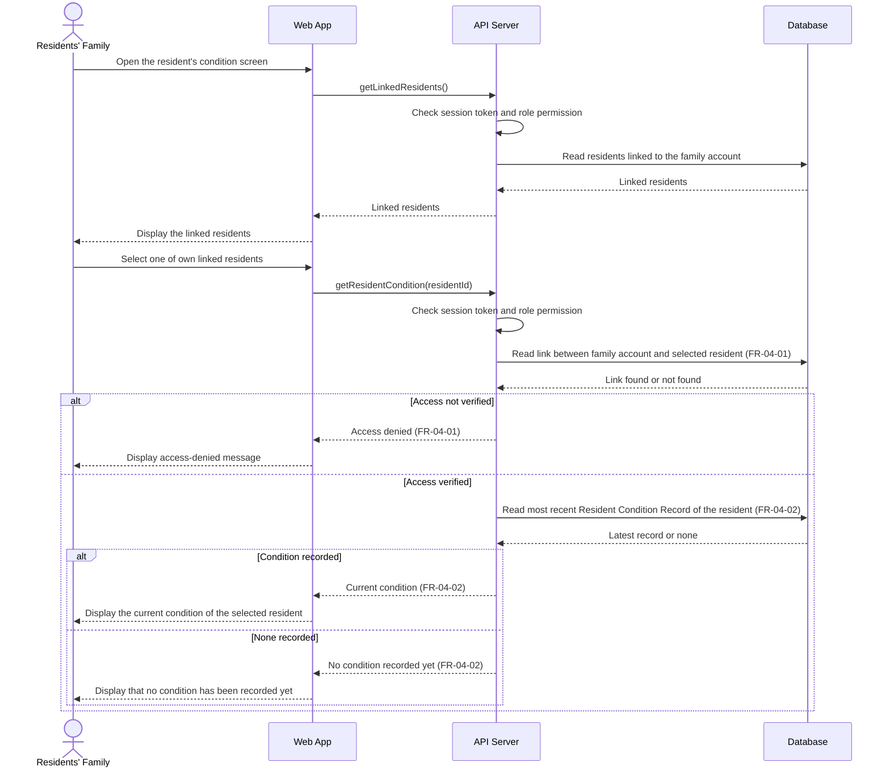

# Sequence Diagram: SD-UC-08 View resident's condition

| Field | Value |
|---|---|
| Use case | UC-08 View resident's condition |
| Version | v1 |
| FRs | FR-04-01, FR-04-02 |

The lifelines follow the Dien Hong use-case diagram's sequence-diagram guidance: Web App, API Server and Database. The Radar Gateway, Scheduler, Notification Service and Browser push service do not take part in this use case, because it only reads data and sends no notice. The API Server's session-token and role-permission check is shown based on the project-wide assumption for use cases that require login (ADR-003); it is not labelled as FR-06-03 because that FR is scoped to UC-11, UC-12 and UC-13.

## Reading notes

- The two `alt` fragments are outcomes decided inside the system, so they appear here as `alt`. They match the two decisions of [AD-UC-08](../activity/AD-UC-08.md): `d1` "Access verified?" is the outer `alt` (FR-04-01), and `d2` "Condition recorded?" is the inner `alt` (FR-04-02). The family member's choice of resident is a step in the activity diagram (`a1`), not a branch here.
- Access is verified on every request by checking that the selected resident is linked to the family account (FR-04-01, BR-04-01). The link itself is created in UC-11 and is not drawn here. The exact verification rule is still an open question in AD-UC-08 (#1), so the default applied there is used.
- "Current condition" is the most recently saved Resident Condition Record (BR-02-02). FR-02-03 keeps every earlier record, so the API Server reads the latest one only. This use case reads the record and never changes it.
- The first block (`getLinkedResidents`) supports the activity step `a1`, where the family member picks one of several linked residents. No FR states it, so it is an assumption taken from AD-UC-08. Remove it if the team decides the list is shown by another screen.
- The access-denied and no-condition messages follow FR-04-01 and FR-04-02. The supplied requirements do not give their exact wording, so none is added here.
- The session-token check returns the user to the sign-in or role home screen (FR-00-01, FR-06-03). That case is not drawn, in line with the project-wide login assumption.
