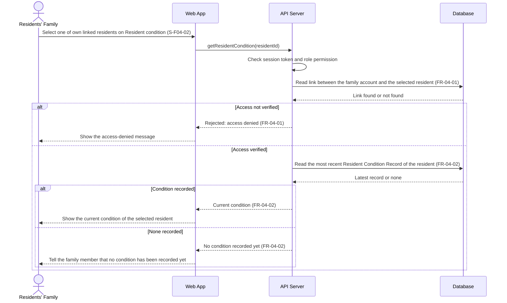

# Sequence Diagram: SD-UC-08 View resident's condition

| Field | Value |
|---|---|
| Use case | UC-08 View resident's condition |
| Version | v1 |
| FRs | FR-04-01, FR-04-02 |

Analysis level: how the parts of the Dien Hong System talk to each other when a family member views the current condition of one of their linked residents. The lifelines are the elements of the physical design. The family member's choice of resident is shown in the activity diagram AD-UC-08, not here.

Both alt fragments are outcomes decided inside the system, so they belong in a sequence diagram. They are the two decisions of AD-UC-08: the outer fragment is d1 "Access verified?" (FR-04-01) and the inner one is d2 "Condition recorded?" (FR-04-02). Choosing one of several linked residents is the family member's choice (a1 in AD-UC-08), so it is the first message and not a fragment. The use case only reads: the API Server takes the latest record and changes nothing (earlier records are kept by FR-02-03).
