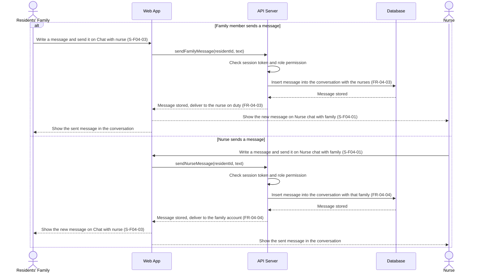

# Sequence Diagram: SD-UC-09 Exchange messages between family and nurses

Analysis level: how the parts of the Dien Hong System talk to each other when a family member and
a nurse exchange messages. The lifelines are the elements of the
[physical design](../architecture/architecture.md). Whether the conversation continues after a
message is shown in the activity diagram [AD-UC-09](../activity/AD-UC-09.md), not here.

| Field | Value |
|---|---|
| Use case | UC-09 Exchange messages between family and nurses |
| Version | v1 |
| FRs | FR-04-03, FR-04-04 |

The two branches are the two directions of the use case. In AD-UC-09 they are the decision `d1`
"Who initiates the message?" (`a1` then `s1` for FR-04-03, `a2` then `s2` for FR-04-04). Who writes
first is the user's choice, so the `alt` here only separates the two directions and is not a
decision made by the system. Sending another message is the loop `d2` in AD-UC-09 and repeats the
same exchange, so it is not drawn as a second fragment. Neither side has to reply (AD-UC-09 open
question 1). The defaults of AD-UC-09 are applied. No nurse-to-resident or nurse-to-family link
is checked, so any family member and any nurse can exchange messages (open question 2), and no
failure flow is drawn: if the message cannot be stored, it is not added (open question 3). The
message goes to "the nurse on duty" as FR-04-03 states, and the diagram shows only that the
system stores and delivers it.
