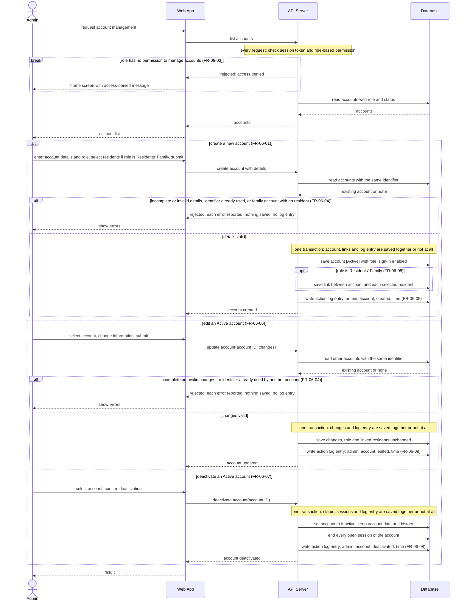

# Sequence Diagram: SD-UC-11 Set up accounts

The Admin's choices (which operation, which role, which residents, confirm or not confirm a deactivation, correct and resubmit or cancel) are shown in the activity diagram [AD-UC-11](../activity/AD-UC-11.md), not here.

| Field    | Value                                                                |
| -------- | -------------------------------------------------------------------- |
| Use case | UC-11 Set up accounts                                                |
| Actor    | Admin                                                                |
| Version  | v1                                                                   |
| FRs      | FR-06-01, FR-06-03, FR-06-04, FR-06-05, FR-06-06, FR-06-07, FR-06-08 |

The `alt` fragments inside each operation are outcomes decided inside the system (valid or not,
identifier already used or not), so they belong in a sequence diagram. 
The three top-level branches are the operation the Admin asks for, which is an Admin choice ; they are shown together only so that one diagram covers all FRs of UC-11. 
The `break` is the system's refusal when the role has no permission (D1 [No]). If the Admin does not confirm a deactivation, no request is sent, so that path does not appear here. After a rejection the Admin can correct and submit again or cancel without saving.

Notes:

- A rejected or refused request changes nothing and writes no action log entry.
- Edit and deactivate only offer Active accounts (A4, A5 in the activity diagram), so the diagram
  does not check the status again.
- After deactivation, FR-06-07 makes the system reject any later sign-in or request made with the account, so those checks are not repeated here.
- Changing the role of an existing account is UC-12 (FR-06-02), not UC-11.
