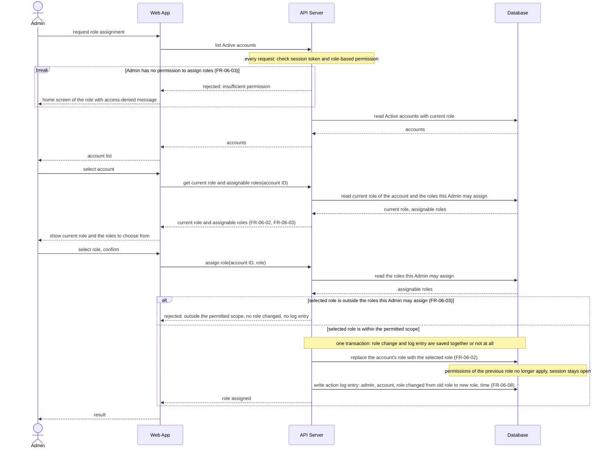

# Sequence Diagram: SD-UC-12 Assign role-based permissions

The Admin's choices (which account, which role, confirm or choose again after a rejection) are shown in the activity diagram [AD-UC-12](../activity/AD-UC-12.md), not here.

| Field | Value |
|---|---|
| Use case | UC-12 Assign role-based permissions |
| Actor | Admin |
| Version | v1 (aligned with AD-UC-12 v0.2) |
| FRs | FR-06-02, FR-06-03, FR-06-08 |

The `break` is the system's refusal when the Admin's role has no permission to assign roles (D1 [No]).
The `alt` is an outcome decided inside the system: the API Server checks again, on its own, that the selected role is one this Admin may assign (D2), so the check does not depend on what the screen offered. The Admin's own choices are not drawn: after a rejection as outside the permitted scope the Admin can choose another role, which is a new run of the second half of this diagram from "select role, confirm".

Notes:

- The role is read from the Database on every request, so the change applies at
  the account's next request and the account does not have to sign out. 
- A rejected request changes nothing and writes no action log entry.
- Only Active accounts are listed, so the diagram does not check the account status again.
- Creating an account with a role and editing account information are UC-11, not UC-12.
