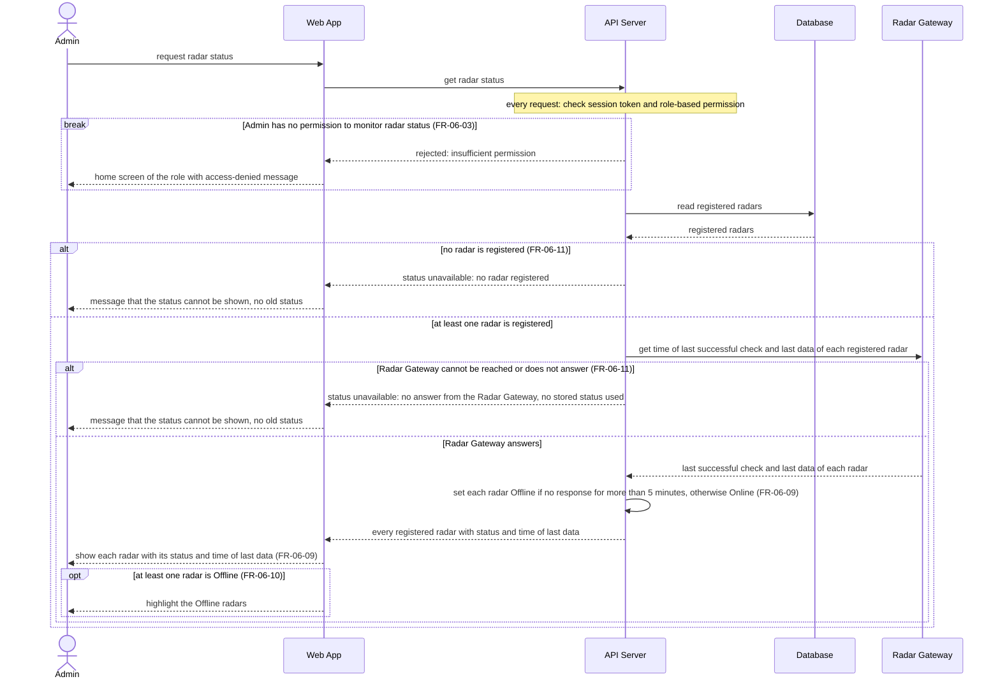

# Sequence Diagram: SD-UC-13 Monitor radar status

The Admin only requests and reads the status, so there is no Admin choice to show here; the three endings (rejected, status unavailable, status shown) are in the activity diagram [AD-UC-13](../activity/AD-UC-13.md).

| Field | Value |
|---|---|
| Use case | UC-13 Monitor radar status |
| Actor | Admin |
| Version | v1 (aligned with AD-UC-13 v0.1) |
| FRs | FR-06-03, FR-06-09, FR-06-10, FR-06-11 |

The `alt` fragments here are outcomes decided inside the system (no radar registered, Radar Gateway not reachable, radar Offline or not), so they belong in a sequence diagram. The `break` is the system's refusal when the Admin's role has no permission (D1 [No]). The API Server asks the Radar Gateway for the status every time the Admin requests it and keeps no copy, so an old status is never shown as the current one (FR-06-11).

Notes:

- UC-13 only reads. No data is changed and no action log entry is written by this diagram.
- A radar only sends abnormal events (UC-06), so a quiet radar may have no recent data. For this reason Online or Offline is worked out from the time of the last successful check or data, whichever is later, and the time of the last data is only shown to the Admin.
- The 5-minute limit comes from the W1 row FR-06-09-BE and is still an assumption.
- The highlight is drawn by the Web App (FR-06-10-FE) from the status the API Server sends.
- "No radar registered" and "Radar Gateway cannot be reached" end with the same message, so they appear as two branches with the same last message.
