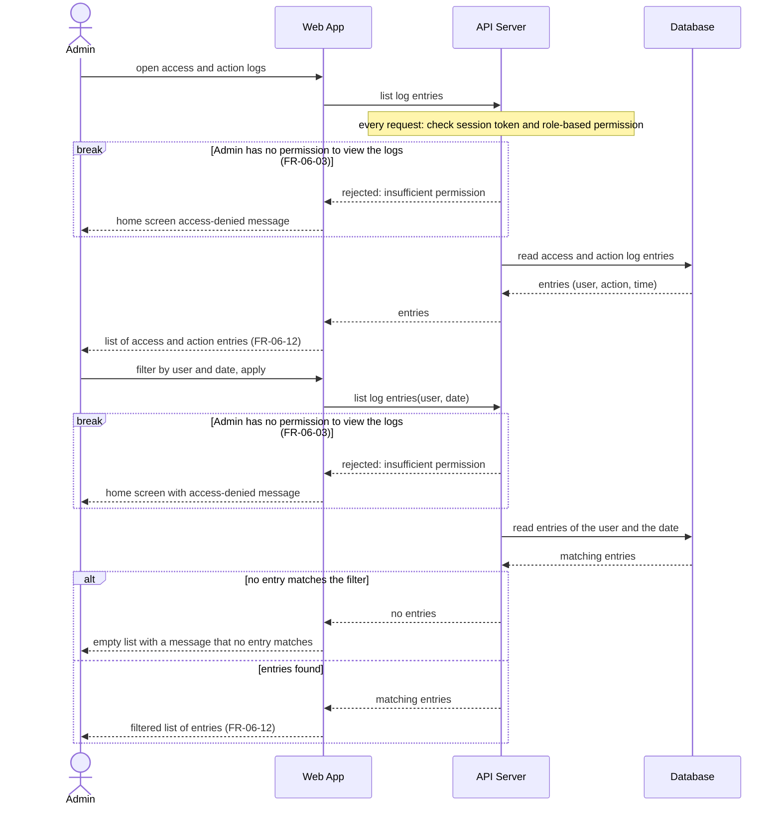

# Sequence Diagram: SD-UC-14 View access and action logs

The Admin's choices (which user, which dates, filter again or stop) are not shown here.
The entries that the Admin reads are written by other use cases (sign-in, FR-06-13, and account and role changes, FR-06-08), not by this one.

| Field    | Value                                                            |
| -------- | ---------------------------------------------------------------- |
| Use case | UC-14 View access and action logs                                |
| Actor    | Admin                                                            |
| Version  | v1                                                               |
| FRs      | FR-06-03, FR-06-12 (the entries come from FR-06-08 and FR-06-13) |

The `alt` is an outcome decided inside the system (entries found or not), so it belongs in a sequence diagram. The `break` is the system's refusal when the Admin's role has no permission to view the logs.
It appears twice because the API Server checks the permission on every request, so a role changed in UC-12 between the first request and the filter request is also respected.

Notes:

- UC-14 only reads. The Admin cannot change or delete log entries here, and no data is changed.
- The "no entry matches" branch is an assumption: FR-06-12 does not say what is shown for an empty result.
