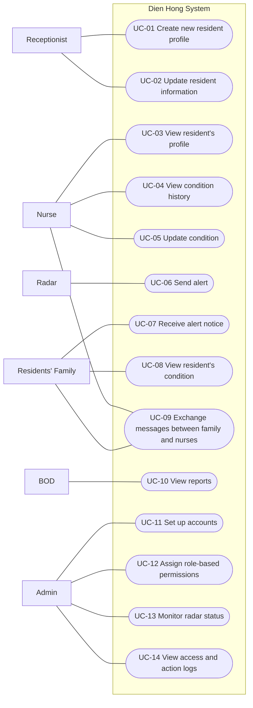

# Use Case Diagram: Dien Hong System

Who wants Dien Hong System to do what. Mermaid has no use case diagram type, so the
diagram below is drawn as a flowchart: people and devices on the outside, use cases (rounded)
inside the system boundary. In a drawing tool use the UML notation (stick figures, ovals).

| Field | Value |
|---|---|
| Version | v1 |
| Actors | Receptionist, Nurse, Residents' Family, BOD, Admin (primary, human); Radar (primary, device, starts UC-06) |

## Diagram

The full use case inventory, with features and login rules, is W0 Table 1 in
[w0-scope.md](../function-list/w0-scope.md).

## Sequence diagrams

One sequence diagram per use case, at analysis level: the lifelines are the elements of the
[physical design](../architecture/architecture.md): Web App (user interface), API Server,
Database, Radar Gateway (receives data from the radar device) and Notification Service
(pushes alerts to the family).

Assumption for every use case with "Login required = Yes": the user has already logged in and
the API Server checks the session token and the role-based permission on every request.

| Use case | Sequence diagram | Status |
|---|---|---|
| UC-01 Create new resident profile | [SD-UC-01](#sd-uc-01-create-new-resident-profile) | Draft |
| UC-02 Update resident information | [SD-UC-02](#sd-uc-02-update-resident-information) | Draft |
| UC-03 View resident's profile | [SD-UC-03](#sd-uc-03-view-residents-profile) | Draft |
| UC-04 View condition history | [SD-UC-04](#sd-uc-04-view-condition-history) | Draft |
| UC-05 Update condition | [SD-UC-05](#sd-uc-05-update-condition) | Draft |
| UC-06 Send alert | [SD-UC-06](#sd-uc-06-send-alert) | Draft |
| UC-07 Receive alert notice | [SD-UC-07](#sd-uc-07-receive-alert-notice) | Draft |
| UC-08 View resident's condition | [SD-UC-08](#sd-uc-08-view-residents-condition) | Draft |
| UC-09 Exchange messages between family and nurses | [SD-UC-09](#sd-uc-09-exchange-messages-between-family-and-nurses) | Done |
| UC-10 View reports | [SD-UC-10](#sd-uc-10-view-reports) | Draft |
| UC-11 Set up accounts | [SD-UC-11](#sd-uc-11-set-up-accounts) | Draft |
| UC-12 Assign role-based permissions | [SD-UC-12](#sd-uc-12-assign-role-based-permissions) | Draft |
| UC-13 Monitor radar status | [SD-UC-13](#sd-uc-13-monitor-radar-status) | Draft |
| UC-14 View access and action logs | [SD-UC-14](#sd-uc-14-view-access-and-action-logs) | Draft |

## Change log

| Version | When | Change | Why |
|---|---|---|---|
| v1 | Initial | Fourteen use cases (UC-01 to UC-14), actors Receptionist, Nurse, Residents' Family, BOD, Admin and Radar | First version based on W0 Table 1 |
